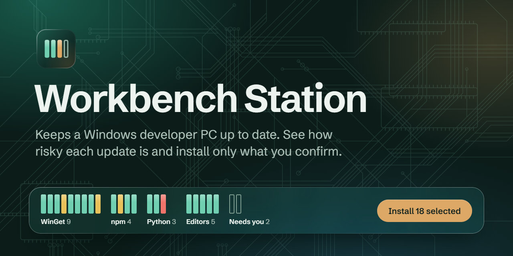
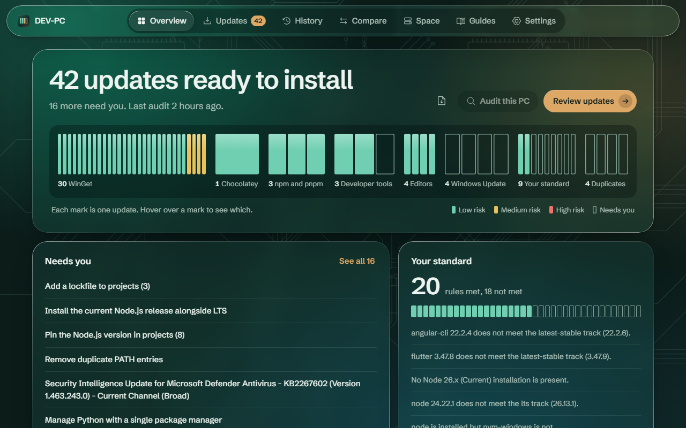
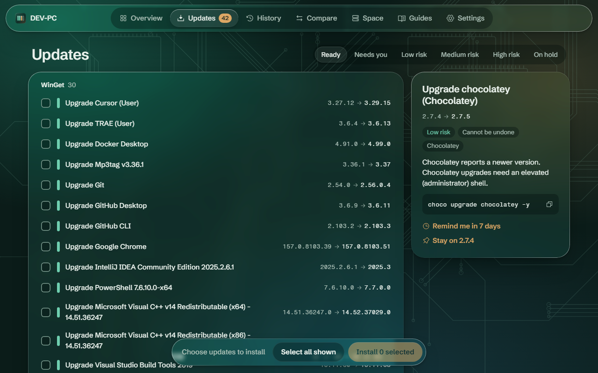
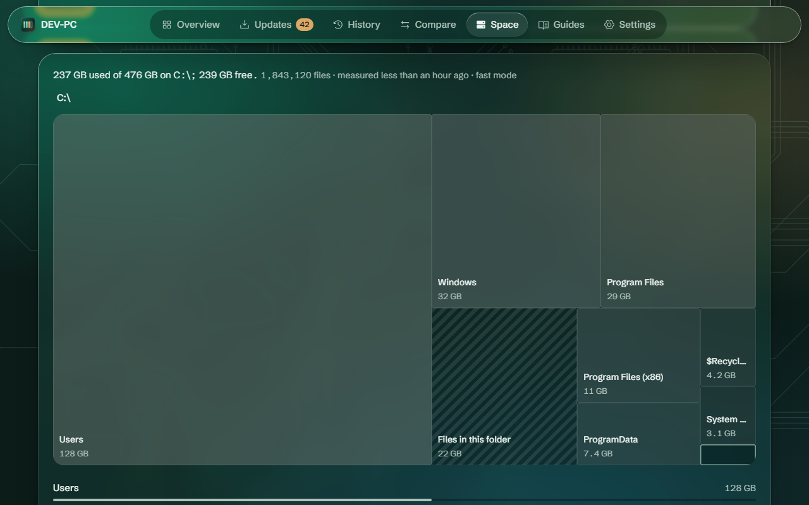

<p align="center">
  
</p>

<p align="center">
  <a href="https://github.com/osozzz/Workbench-Station/releases/latest"></a>
  <a href="https://github.com/osozzz/Workbench-Station/actions/workflows/validate.yml"></a>
  <a href="LICENSE"></a>
  <a href="https://github.com/osozzz/Workbench-Station/releases"></a>
</p>

<p align="center">
  <a href="https://github.com/osozzz/Workbench-Station/releases/latest"><b>Download for Windows</b></a>
  ·
  <a href="#install">Install</a>
  ·
  <a href="PRIVACY.md">Privacy</a>
  ·
  <a href="#command-line-engine">Command line</a>
</p>

Workbench Station keeps the apps and developer tools on a Windows PC up to date. It audits what is installed, shows every update it found with how risky it is and the exact command it will run, and installs only the ones you pick. It also shows what takes up space on your drives and helps you free it, one confirmed item at a time.

It is a desktop app in English and Spanish, built on a PowerShell engine you can also run on its own.

<picture>
  <source media="(prefers-color-scheme: light)" srcset="docs/assets/screenshots/overview-light.png">
  
</picture>

## What it does

- **Audit** Windows, WinGet, Chocolatey and Microsoft Store apps, Windows Update, WSL, editors and their extensions, and the developer toolchains: Node.js, npm and pnpm, Java, Flutter and Android, Python, .NET, Rust and Go. It also checks PATH, your projects and their Git repositories. An audit only reads.
- **Updates** lists everything that can be updated, grouped by source, with its risk, its current and new version and its exact command. Install the ones you select, put one off for a week, or stay on a version.
- **History** shows how each install went.
- **Your standard** compares the PC with a declared standard (`config/workstation.policy.json`), such as "the current Node.js LTS" or "no duplicate PATH entries".
- **Compare** puts this PC next to another one: apps, tool versions, PATH, projects and Git.
- **Space** shows what fills a drive or folder as a map you can open folder by folder, with the largest files and the size of each file type. Its fast mode reads an NTFS drive's file table, like WizTree, and adds up to the space Windows reports as used.
- **Free up space** lists package caches, build folders in your projects, old temporary files, WSL and Docker disks and Windows Update leftovers, each with its size and exact command.
- **Automatic audit** runs on a schedule and tells you when updates are waiting. The app itself updates in the background and installs the new version when you restart it.

<p>
  
  
</p>

## How it stays safe

- Nothing changes on its own. An audit, a comparison and a space scan only read. Installing an update or cleaning an item happens only after you confirm it, and you see the exact command first.
- Updates that need administrator rights ask Windows each time. The app itself installs and runs without them.
- An update plan older than a day is locked until you audit again, so it never installs against an old picture of the PC.
- Cleaning uses each tool's own command (`npm cache clean`, `docker system prune` without volumes…), and folders go to the Recycle Bin. Build folders count only inside your project folders and next to their project file. Your personal files are never touched. The rules are in [`docs/policies/cleanup-safety.md`](docs/policies/cleanup-safety.md) and [`docs/policies/update-execution-safety.md`](docs/policies/update-execution-safety.md).
- Reports stay on your PC. Nothing is sent anywhere except what [`PRIVACY.md`](PRIVACY.md) lists.

## Requirements

- Windows 11, or Windows 10 22H2 or later, 64-bit.
- Microsoft Edge WebView2, which Windows 11 already has. On Windows 10, the installer downloads it if it's missing.
- [WinGet](https://learn.microsoft.com/windows/package-manager/winget/) (App Installer) to audit and update most apps. It comes with Windows 11 and current Windows 10.

## Install

1. Download `Workbench-Station_<version>_x64-setup.exe` from the [latest release](https://github.com/osozzz/Workbench-Station/releases/latest).
2. Run it. It installs for your user only, so it doesn't ask for administrator rights.
3. The installer isn't code-signed yet, so Windows SmartScreen may say it "protected your PC". Choose **More info**, then **Run anyway**. Signing is on its way through [SignPath Foundation](#code-signing-policy).

On first run, the app asks for your project folders, so it can check their dependencies and Git, then walks you through the first audit.

### Check your download

Each release lists the installer's SHA256 in `SHA256SUMS.txt`, and GitHub records how it was built.

```powershell
Get-FileHash .\Workbench-Station_3.0.0_x64-setup.exe -Algorithm SHA256   # compare with SHA256SUMS.txt
gh attestation verify .\Workbench-Station_3.0.0_x64-setup.exe --repo osozzz/Workbench-Station
```

The attestation proves that the file was built from this repository by [`release.yml`](.github/workflows/release.yml) on GitHub Actions.

## Privacy

No account, no telemetry. Reports and settings stay in `%LOCALAPPDATA%\com.osozzz.workbenchstation`. The app checks GitHub for a new version of itself once a day, which you can turn off in **Settings**. An audit asks public sources for the latest version of each tool. Details in [`PRIVACY.md`](PRIVACY.md).

## Uninstall

Windows **Settings > Apps > Installed apps > Workbench Station > Uninstall**. The uninstaller also removes the automatic audit, and it can delete your settings and reports.

## FAQ

**Does it update anything without asking?**
No. Even the automatic audit only reads and then tells you what it found.

**Why does an update ask for administrator rights?**
Some installers need them, such as system-wide apps, Chocolatey and Windows components. Windows asks for each one, and you can say no.

**What is "Your standard"?**
A list of rules your PC should meet, in `config/workstation.policy.json`. The app shows the ones that aren't met and, when an update can fix one, adds it to the list.

**Can I use it on a PC without the app?**
Yes. The engine is plain PowerShell; see [Command-line engine](#command-line-engine).

**How do I report a problem?**
[Open an issue](https://github.com/osozzz/Workbench-Station/issues/new/choose) with **App problem**. For anything security-related, see [`SECURITY.md`](SECURITY.md).

## Command-line engine

The app runs the PowerShell scripts in `scripts/`, and you can run them yourself from a clone. They work on Windows PowerShell 5.1 and PowerShell 7.

```powershell
.\Run-Audit.cmd                                   # audit this PC; reports go to .\reports
.\Run-Evaluate.cmd <report.json>                  # evaluate the report against the standard
.\Run-Plan.cmd <report.json>                      # list everything that can be updated (runs nothing)
.\Run-Update.cmd <update-plan.json> -Risk low     # preview updates; add -Apply to run them, confirming each
.\Run-Compare.cmd <reference.json> <target.json>  # compare two audit reports
.\scripts\Clean-Workstation.ps1 -List             # what can be cleaned, with sizes and commands
```

Project and Git discovery needs `config\workstation.local.json`; see [`config/README.md`](config/README.md). The full procedure is in [`docs/audit/running-the-audit.md`](docs/audit/running-the-audit.md).

## Contributing

Issues and pull requests are welcome. [`CONTRIBUTING.md`](CONTRIBUTING.md) explains how to build the app, run the tests and propose a change. The documentation, the roadmap and the release process are in [`docs/`](docs/README.md).

## Code signing policy

Windows installers are built from this repository by [`release.yml`](.github/workflows/release.yml) on GitHub Actions; nothing is built or signed on a personal machine. Every release is approved by hand before it is published.

| Role | Who |
| --- | --- |
| Authors (committers) | [Alejandro Osorno](https://github.com/osozzz) |
| Reviewers | [Alejandro Osorno](https://github.com/osozzz) |
| Approvers | [Alejandro Osorno](https://github.com/osozzz) |

Privacy: see [`PRIVACY.md`](PRIVACY.md). This program will not transfer any information to other networked systems unless specifically requested by the user or the person installing or operating it, except for what that page describes.

## License

MIT. See [`LICENSE`](LICENSE).
